# Pipelines, versions and releases

How every SpaceWorks-Labs repository checks, versions and ships its work: the uniform rules all of them follow
and the way each kind of stack does it. These are rules, not a status report; nothing here says where a particular
repository stands today.

Plain words used below: a **workflow** is a script GitHub runs for us (GitHub Actions); a **job** is one
step-group inside it; a **required check** is a job that must be green before GitHub allows a merge;
**ghcr.io** is GitHub's container registry, where our Docker images live; a **tag** is a permanent label on one
commit; **semver** is the three-number version `MAJOR.MINOR.PATCH`.

## 1. Rules every product follows

| Rule | What it means |
|---|---|
| **Branch model** | Work happens on a branch from `dev`. A pull request (PR) goes into `dev`. The maintainer promotes `dev` to `main` with a second PR. Nobody pushes to `main`. |
| **Checks run on every PR** | A PR into `dev` or `main` runs the repository's checks. Nothing merges red. |
| **Required checks are named and stable** | Branch protection matches job names, so a job that is required is never renamed casually. |
| **Zero reds** | A failing test is a new regression, never "background noise". Tests are kept; a test for an unshipped feature is skipped with a written reason, never deleted. |
| **Semver in a `VERSION` file** | The root `VERSION` file holds `MAJOR.MINOR.PATCH`. It is raised (strictly higher than `main`) on every PR into `main`. |
| **A release note per version** | `docs/release-<version>.md` (SpaceWorks) or the changelog entry says what changed, in plain English. |
| **Tags are `vX.Y.Z-main.<run>.<sha>`** | The build tag combines the series, the CI run number and the commit. Servers pin that exact tag, so an update always means one known build. The person-facing title is `<Product> X.Y.Z`. |
| **Releases are built by CI only** | The first time a new `VERSION` reaches `main`, CI builds the images and creates the GitHub Release. Nobody builds or uploads a release by hand. |
| **Artifacts per kind** | Server products: two Docker images (backend, frontend) for `linux/amd64` and `linux/arm64`, plus installer files. Android: APK and app bundle. iOS: an app build. Static sites: a Pages deployment. |
| **Security audits** | Dependencies are audited in CI (`pip-audit` for Python, `npm audit` for Node), on PRs and weekly where the dependency files rarely change. |
| **Caching** | Every workflow caches its package manager or build layers so a PR check stays fast. The cache is never the source of truth. |
| **Secrets only in GitHub** | Tokens and keys live in GitHub secrets and environments, never in a file. Test keys are generated fresh in each run. Releases are signed without a stored key where possible (keyless signing). |
| **Least permission** | Workflows start with `contents: read` and ask for more (`packages: write`, `pages: write`) only in the one job that needs it. |
| **Concurrency** | A newer run on the same branch cancels the older check run. A release run never cancels itself halfway. |
| **Maintainer merges** | `CODEOWNERS` asks the maintainer to review every path, and branch protection (applied to admins too) lets only the maintainer merge or push to `main`. Agents prepare the merge and stop. |
| **Pages deploys** | Static sites build on every PR (to catch broken pages) and publish to GitHub Pages only from `main`. |

### The flow, end to end

```mermaid
flowchart LR
  feat["Feature or fix branch from dev"] -- "pull request" --> dev["dev"]
  dev --> pr_checks["PR checks: build, lint, types, tests, audit"]
  pr_checks -- "all green" --> promote["Maintainer opens PR dev to main"]
  promote --> bump["version-bump check: VERSION strictly higher, release note exists"]
  bump -- "green" --> merge["Maintainer merges to main"]
  pr_checks -. "red: fix and push again" .-> feat
  merge --> release["Release workflow on main"]
  release --> new{"New VERSION?"}
  new -- "yes" --> images["Build and push images to ghcr.io"]
  images --> assets["Installer files, signed checksums"]
  assets --> gh["GitHub Release created"]
  gh --> latest["Marked latest, rolling tags promoted"]
  latest --> deploy["Optional: deploy to our own server"]
  new -- "no" --> imgonly["Images only, no GitHub Release"]
```

## 2. Stack 1: Django, DRF and React (SpaceWorks)

The main product, with the most complete pipeline. Four workflows in `.github/workflows/`.

### Checks (`checks.yml`)

Runs on PRs into `main` or `dev`, on pushes to `dev`, and by hand. Fast checks only, no test suites. Job
names are the required checks.

| Job | What it checks |
|---|---|
| `frontend` | Node 22, `npm ci`, TypeScript (`tsc -b`), production build including the PWA verify script. npm cache. |
| `backend` | Python 3.12, `pip install`, Django `manage.py check`, and `makemigrations --check` (no missing migrations). Throwaway keys come from `scripts/ci/throwaway_keys.py`. pip cache. |
| `contracts` | The OpenAPI snapshot `frontend/openapi-schema.json` matches the code, the generated client `frontend/src/generated/api.ts` matches the snapshot, and the tenant-dump catalogue digest is valid. |
| `rules` | `scripts/ci/check_rules.py`: the 300-line file ceiling and `CLAUDE.md` equals `AGENTS.md`. |
| `version-bump` | PRs into `main` only: `scripts/ci/check_version_bump.py` compares `VERSION` with the base branch and existing tags. |

### Tests (`tests.yml`)

The full committed suites (decision 244: CI runs the committed tests). Backend pytest is split into **6 shards**
and each shard runs in the same isolated Docker runner as local work (`scripts/dev.sh test`, throwaway
Postgres 16, Redis and object store). Frontend runs the whole vitest suite plus two `node:test` suites (website
serving, documentation contracts). Not in the required list yet.

### Security audit (`security-audit.yml`)

`pip-audit` against `backend/requirements.txt`, enforcing (a vulnerable dependency fails the check). Runs when
the requirements change, on PRs, and **weekly (Monday 03:23 UTC)**.

### Continuous release (`release.yml`)

Runs on every push to `main` (and by hand). Every commit on `main` builds images; **a GitHub Release is cut
only when `VERSION` is new**.

| Job | What it does |
|---|---|
| `prepare` | Reads `VERSION`, refuses a non-semver value, refuses a push that did not raise it (or a tag that already exists), builds the identifiers: image tag `X.Y.Z-main.<run>.<12-char sha>`, git tag `v` plus that. |
| `publish` | Builds and pushes **two images**, `spaceworks-backend` and `spaceworks-frontend`, to `ghcr.io/spaceworks-labs/`, for `linux/amd64` and `linux/arm64`, with GitHub Actions layer cache, then verifies the published manifest. |
| `assets` | `scripts/release-assets.sh` builds `install.sh`, the deploy bundle `spaceworks-<version>.tar.gz`, `release.json` and `SHA256SUMS`. **cosign** signs the checksums keylessly with the workflow's GitHub identity (`SHA256SUMS.sig`, `.pem`). |
| `github-release` | Creates the release titled `SpaceWorks <version>` with generated notes (from merged PRs), the images list and the assets. Created **not** latest at first. |
| `promote-latest` | Only if this is still the head of `main`: promotes images to the rolling tags, marks the release **latest** (which is what `releases/latest/download/install.sh` serves), prunes old image versions (release history kept forever) and checks the immutable images pull. |
| `deploy` | Optional, runs only when the repository variable `SPACEWORKS_DEPLOY` is `true`: a self-hosted runner on our server (environment `production`) runs `scripts/update.sh` for that exact version. |

### Version rule (CLAUDE.md and `docs/project/release-process.md`)

Every merge or push to `main` raises `VERSION` strictly. Strings that must match: `SPECTACULAR_SETTINGS["VERSION"]`,
`info.version` in the OpenAPI snapshot, and the README badge. `sh scripts/bump-version.sh <new-version>` updates
them, creates `docs/release-<version>.md` from a template and runs the check. Releases so far: 0.9.1, 0.9.2,
0.9.3 (latest published); 0.12.0 is prepared.

### Other files

`.github/CODEOWNERS` (`* @<maintainer>`), `CHANGELOG.md`, issue and PR templates, `scripts/ghcr-retention.py`.

## 3. Stack 2: Next.js and Prisma (Workspace, Events, Machines, Inventory, Bookings, Organization)

Six products on the same shape: Node 22, Prisma on PostgreSQL 16, Redis, Playwright browser tests, two images
(`spaceworks-<product>-backend`, `spaceworks-<product>-frontend`), a one-command VPS installer.

### Quality and CI workflows

| Repo | Workflows | What they check |
|---|---|---|
| **Workspace** | `quality.yml` ("Quality gate", on PRs and pushes to `main`/`dev`) calls `ci.yml`; `release.yml` | `ci.yml`: lint, typecheck, unit tests, build, Prisma validate, frontend typecheck and build; PostgreSQL + Redis + object-storage integration tests; `npm audit` (advisory, non-blocking); **hosting smoke** with Playwright on a `split` and a `vps` matrix. Quality gate adds deployment-script and Helm chart lint, the isolated Cloudflare cron package audit and dry run, and a **two-image installer smoke** (install and restore on empty volumes). |
| **Inventory** | `quality.yml` ("Quality gate") calls `ci.yml`; `release.yml` | The same pattern as Workspace. |
| **Events** | `ci.yml`, `quality.yml` ("Quality gate"), `release.yml`, `yuyu-upstream.yml` | Lint, generated help index and frontend catalogue freshness, typecheck, unit and coverage tests, integration, `npm audit` (blocking, high), **migration integrity** (`db:deploy`, `db:verify`, schema diff), production check, container build and smoke test, Playwright (production flows and a fake payment provider). Actions are pinned to commit hashes. A weekly job lists new commits in the upstream project it was derived from. |
| **Machines, Bookings, Organization** | `tests.yml`, `security-audit.yml`, `release.yml` | `tests.yml`: `CLAUDE.md` equals `AGENTS.md`; lint, Prisma validate, typecheck, unit tests, frontend catalogue check, build; PostgreSQL + Redis integration and Playwright end to end (failure uploads the report, kept 7 days); `shellcheck` on installers; compose files resolve in every layer; **images build and the bundled stack runs** (compose smoke, installer and encrypted recovery). `security-audit.yml`: `npm audit --omit=dev --audit-level=high` on PRs. |

### Release workflows

| Repo | Trigger | Behaviour |
|---|---|---|
| Workspace, Events, Inventory | Runs after the Quality gate succeeds on `main` (`workflow_run`), or by hand | `prepare` decides by **state**: the first `main` build of a `VERSION` makes a release; reruns and later commits of the same `VERSION` publish images only. Builds each architecture on its own runner (`amd64` and `arm64`), pushes by digest, then `publish` merges a multi-platform manifest and tags `X.Y.Z-main.<run>.<sha>`, `sha-<12>`, and for releases `main`, `latest` and the series. A manual run on another branch makes a **pre-release** ("test build"). Inventory also publishes `dev` images from the `dev` branch. Release notes include the one-line installer. Workspace also publishes the secrets CLI and Node SDK to GitHub Packages. |
| Machines, Bookings, Organization | Push to `main` or `dev`, or by hand; calls `tests.yml` first | Same four-job shape as SpaceWorks: `prepare`, `build` (per architecture), `publish`, `github-release`, `promote-latest`. A `main` push publishes both images and a release, then promotes to `latest`, `main` and the series. A `dev` push publishes images tagged `dev` and `<VERSION>-dev.<run>.<sha>` and never makes a release, `latest` or a deploy. Release notes are generated from merged PRs. |
| All six | Optional | A `deploy` job on a self-hosted runner with the `production` environment (Bookings, Events and others), opt-in. |

Differences from the Django stack: **no `version-bump` check on PRs** and **no cosign-signed installer
assets** (the installer is `install.sh` in the repository, pinned by tag). Releases are still decided by
`VERSION`, but a PR that forgets to raise it is not stopped before merge: the release simply does not happen.
Versions today: Workspace 0.10.0 (latest release 0.6.7), Events 0.12.0, Machines 0.6.0, Inventory 0.6.0,
Bookings 0.6.0, Organization 0.8.1. Note Workspace's `VERSION` is ahead of its last release.

## 4. Stack 3: Android (Kotlin, Gradle)

One workflow, `android.yml`, on every push, PR and by hand. Actions are pinned to commit hashes, `persist-credentials` is off, and design submodules are fetched recursively.

| Job | What it does |
|---|---|
| `build` (required) | Temurin Java 21, Android SDK, Gradle with cache (read-only for forked PRs). `./gradlew lint test assembleDebug assembleRelease bundleRelease`. Then checks the native libraries and APK for **16 KB page alignment** (`scripts/check_native_packaging.py`). Uploads lint reports, debug and release APKs, the release bundle and the R8 mapping file as an artifact. |
| `ui` (required: `UI (phone)`, `UI (tablet)`) | Android emulator (API 35, KVM) runs the native UI journeys on a phone and a tablet profile. A **manual run** widens the matrix to ten device sizes. Reports and screenshots are uploaded. |

Versioning: `versionCode` and `versionName` come from Gradle properties `spaceworks.versionCode` and
`spaceworks.versionName`, defaulting to `1` and `0.1.0`; the build script comments that store uploads inject
fresh values without editing source. A `signingConfig` named `upload` is looked up when present. **No workflow
signs the APK or publishes a GitHub Release today**; CI builds the unsigned release APK and bundle. The product
rule is that apps are distributed through GitHub Releases, so a signed-APK release workflow is a gap.

## 5. Stack 4: iOS (Swift, Xcode)

One workflow, `ios.yml`, on every push, PR and by hand (manual diagnostics are opt-in inputs). Runs on
`macos-15` with Xcode 26.2 pinned.

| Step group | What it does |
|---|---|
| Tooling | Verifies the pinned Xcode and SDK, installs `xcodegen` and `librsvg`, checks build tools. |
| Caches | Swift package sources and compiled intermediates, keyed by Xcode and SDK identity and the package files. Saved only after validation passes. |
| Generate and validate | `scripts/generate.py`, Python unit tests, `scripts/lint.py`, `xcodegen generate`, then a reviewed dependency lock check. |
| Build and test | `build-for-testing`, built bundle metadata check (families, orientations, single scene), native state and API tests, then UI journeys, on `phone` and `tablet` simulators (required: `Build and test (phone)` and `(tablet)`). A manual run widens to six device profiles. |
| Release compile | On the phone job only: an **unsigned Release** build for a physical device and a bundle resource audit. |
| Evidence | Uploads results, screenshots and validation JSON, kept 7 days. |

Versioning: `project.yml` carries `MARKETING_VERSION: 0.1.0` and `CURRENT_PROJECT_VERSION: 1`. CI never signs,
archives or uploads a `.ipa`, and **no GitHub Release is created** today. Both mobile repos run PR checks with
`strict` up-to-date branches, which the server repos do not.

## 6. Stack 5: static sites (Website, Docs, Design System)

> **Current rule (v2.0.1, 2026-11-13):** The SpaceWorks-Docs row is a historical site snapshot. SW-405 (2026-11-13) retires that separate site: each product owns its in-product feature docs; native apps link to the hub. The stack heading is retained for route stability. (1A-N32) — supersedes the line above; see [docs/current-rules.md#cr-delivery-01](current-rules.md#cr-delivery-01).

| Site | Workflow | What it does |
|---|---|---|
| **Design System** (`SpaceWorks-Design-System`) | `deploy-site.yml` | On PRs: builds only, so a broken page or link fails before `main`. First runs `scripts/check-previews.mjs` (animated previews match the token and motion sources), then in `site/` runs `npm ci` and `npm run build`, which syncs the kit, runs `check-tokens.mjs` (site colours equal the tokens) and the Astro link validation. On `main`: uploads `site/dist` and deploys to GitHub Pages (environment `github-pages`, concurrency group `pages`). Site URL from the `DESIGN_SITE_URL` variable. |

Every static site (a landing page, a docs site, this design system) builds on every pull request and publishes only from
`main`. Its public URL and base path are configuration, never hard-coded; the design system is served at
`system.<domain>` and product docs at `docs.<domain>`.

Design System version: the kit is **Design System v2.0** (named in `README.md` and in the motion-kit note);
there is **no `VERSION` file, no git tag and no GitHub Release yet**. The product release it tracks is the
SpaceWorks release it was synced to (for example "0.12.0 token sync"). Rule going forward: tag the repository
`v2.0.0` when a wave is complete, and bump the minor for added tokens or motion families.

> **Current rule (v2.0.1, 2026-11-13):** Observed at 2026-11-13: v2.0.0 was released 2026-11-13 (owner/lane record; local tag v2.0.0 exists). The v2.0.1 fix checkpoint calls for VERSION 2.0.1; this checkout still reads 2.0.0 at the batch baseline, so that bump is pending the release owner. Ledger 397 sets the phase-2 additions to v2.1.0. A target version is not a published release. (1A-N31) — supersedes the line above; see [docs/current-rules.md#cr-release-01](current-rules.md#cr-release-01).

## 7. Checklist for a new repository

> **Current rule (v2.0.1, 2026-11-13):** This checklist states the desired pipeline, not authorisation to provision it now. SW-386 (2026-11-13) defers workflows, CODEOWNERS and branch-protection changes; preserve existing automation. (1A-N35) — supersedes the line above; see [docs/current-rules.md#cr-delivery-01](current-rules.md#cr-delivery-01).

1. `dev` and `main` branches; `main` protected (maintainer-only, admins enforced, no force-push).
2. A PR workflow whose job names are the required checks.
3. A `VERSION` file, a `version-bump` job and a release note per version.
4. A release workflow that triggers on `main`, builds the artifacts, tags `vX.Y.Z-main.<run>.<sha>` and creates the GitHub Release.
5. `.github/CODEOWNERS` with `* @<maintainer>`.
6. A dependency audit on PRs and weekly.
7. Secrets and signing keys only in GitHub secrets or environments.

## Branch protection (every repository)

In every SpaceWorks-Labs repository, `main` and (where it exists) `dev` are protected: only the maintainer account may
push or merge, the rule applies to admins too, and force-pushes and deletion are blocked. Required status checks are
the jobs the repository's pull-request workflow names; adding the missing ones is part of the CI/CD rule in
[product rules section 14](product-rules.md).
