# Motion flow

Decision **399 (2026-11-13)** governs choreography, timing, interruption and accessible end states. This reference covers the 14 portable motion families audited in batches 2M/2A. [The catalogue](motion.md) records the shipped app; [current rules](current-rules.md#cr-motion-01) resolve historical statements. The [box-open family](../motion/box-open/README.md) remains owned by the logo lane, including its one-cycle completion semantics. Its source is unchanged by this batch.

## Choreography

An entrance and its exit share their origin: a drawer returns to its own edge, a sheet to the bottom, a menu to its anchor and a toast to its arrival offset. Exit lasts approximately **75%** of enter. Start the parent surface before its children; use **fast / 4** between children, with a maximum of eight for a list. Do not combine a route entrance and a second nested list entrance for the same content arrival. Persistent chrome stays still.

```mermaid
sequenceDiagram
    participant U as User
    participant P as Parent surface
    participant C as Children (maximum eight)
    U->>P: Open / navigate / select
    P->>P: Enter with enter easing
    P->>C: Parent established; stagger fast / 4
    C->>C: Reveal in reading order
    U->>P: Close
    P->>P: Same origin, exit easing, 75% duration
    P->>U: Restore focus after final close
```

Only one overlay is visible, including an exiting layer. Replacement requests overwrite one pending request; the next layer waits until the current one is gone. A modal makes background siblings inert, locks document scrolling, contains focus and closes on Escape. Menu semantics remain non-modal. The [complete controller](../motion/overlays/overlays.js), its [HTML demo](../motion/overlays/demo.html) and [React adapter](../motion/overlays/react/OverlaysDemo.tsx) ship these behaviours together. For a full-screen product layer, use a viewport frame and the same controller; the documentation frame deliberately constrains paint.

```mermaid
stateDiagram-v2
    [*] --> Idle
    Idle --> Entering: open A
    Entering --> Open: enter completes
    Entering --> Exiting: close / request B
    Open --> Exiting: close / request B
    Exiting --> Entering: reopen A from current value
    Exiting --> Idle: exit completes; no pending request
    Exiting --> Entering: exit completes; open latest B
```



The kit keeps the same node for reversible states. The item that opens is the item that closes. Initial indicator placement is immediate. Skeleton/loading state, one page-arrival stagger, passive display arrival and once-only landing reveals are documented initial-render exceptions. Feedback starts after a real action; decorative demo loops start paused. Initial theme selection paints before the first frame without animation.

## Duration and easing scale

Read [tokens/tokens.css](../tokens/tokens.css). Do not copy numeric timing or cubic-bezier strings into consumers. Motion time scales with travel and surface size, while input remains available throughout.

| Distance / surface | Enter / change | Exit | Easing |
|---|---|---|---|
| Press; small anchored menu, up to 4 px | `--sw-dur-fast` (120 ms) | fast × .75 (90 ms) | standard for state, enter / exit for layers |
| Dialog, toast, disclosure surface; 4–16 px or small scale | `--sw-dur-base` (180 ms) | base × .75 (135 ms) | enter / exit |
| Drawer, route pane, large card flip | `--sw-dur-slow` (240 ms) | `--sw-dur-base` (180 ms) | enter / exit; standard for direct state changes |
| Child sequencing | fast / 4 (30 ms) | children exit with parent | enter |
| Landing reveal; 24 px, page-level | local 640 ms alias = slow × 8/3 | once-only | enter |
| Passive display fade | local 400 ms alias = slow × 5/3 | slide replacement | enter |
| Theme snapshot circle, viewport-sized | `--sw-theme-duration` = slow × 3 (720 ms) | reverse the existing mask | standard |
| Optional success / decorative moments | local aliases in the family README | finish or explicit pause | closest shared easing |

`--sw-ease-standard` serves state retargeting and direct manipulation; `--sw-ease-enter` decelerates arrivals; `--sw-ease-exit` accelerates departures. Scroll progress is position-driven, so the landing sequence uses its documented smoothstep mapping rather than creating timed animations behind the scroll position. Browser smooth-scroll timing is not a token-controlled animation; use an instant scroll when deterministic timing is required.

Each family stylesheet declares any missing step as a local custom property derived from the closest duration token. [flow-local-tokens.json](../motion/flow-local-tokens.json) and the **Local token steps for batch 1B** tables in each README enumerate them for promotion by batch 1B. `--sw-i` is a bounded unitless search-row index, not a duration. `--sw-demo-ease` selects one of the three easing tokens in the easing teaching example. Global token files are unchanged.

Durations reported by the [easing controls](../motion/hover-press/demo.html) are the durations actually used. The separate site component `site/src/components/MotionTokens.astro` is outside this batch; its DSA-033 correction must be applied by the site owner.

## Interruption model

For an ordinary state reversal, CSS transitions interpolate from their current computed value. Retarget `data-state`; do not remove and re-add classes, replace the node or reset its animation time. Use the same transform endpoints in both directions, with the exit duration/easing on the closed state. Rapid toggles leave the latest requested state authoritative. A cancelled exit cannot remove a reopened node.

Route navigation commits once and gives the latest request ownership of snapshot cleanup. Back/forward and same-page query/hash changes preserve their own scroll and focus contracts. Routes replace content; they are not reversible disclosures. One-shot feedback and explicit Replay controls ignore replay while the current moment runs, preventing duplicate plays. Theme reveal holds one old/new snapshot pair and reverses the current circle animation for a request back to the previous painted state.

The framework-free [flow helpers](../motion/flow.js) await actual animation completion. Timers in reference presence hooks read token durations. The toast's **8,000 ms** success timeout is reading time from UX P30, separate from motion timing. Errors have no automatic timeout. Hover, focus, and an awaited Undo pause the remaining success time. Undo failures persist, and a focused toast restores focus to another toast action or its opener before removal. Status uses a single polite region; failures use an alert region. Status changes do not steal focus.

## Compositor and layout

Animate only **transform and opacity**, including the transform longhands translate/rotate/scale. The named exceptions are the areas-panel `clip-path` wipe and the theme snapshot `clip-path` circle. Filter is allowed only when a family explicitly documents its purpose; no family currently requires it. Do not animate width, height, top, left, grid tracks, background-position, shadows or surface colours. Colours can change immediately. Focus rings are immediate.

Progress uses a full-width fill with `scaleX(value / 100)` and a left origin. Search reserves its complete field slot. Disclosure reserves its content footprint and transitions only its inner surface; closed content is inert and aria-hidden. A compact native disclosure may change document layout instantly when that is the intended reading flow, but layout is never tweened. Static widths and anchored positions are measurements, not animated properties. Card sheen translates as a static texture; sprite artwork translates as a static frame.

Let the browser manage compositor promotion. The recipes do not retain `will-change` on idle elements. Scroll and pointer updates run at most once per animation frame; layout measurements belong to setup/resize and coordinate mapping, not a read/write loop over animated layout properties. The scroll story resets its inline transforms when the viewport or reduced-motion preference switches to a static layout.

## Reduced motion and image previews

Every family includes an explicit `prefers-reduced-motion: reduce` floor: no animation or transition and the same usable end state. Dialog focus, Escape, inertness, scroll lock, live status and progress semantics still work. Reduced-motion card flipping remains an instant front/back action; tilt is suppressed. Kiosk/TV zero movement distances and retain only permitted fades.

Animated WebP/GIF timelines do not obey CSS animation-play-state. Every owned demo therefore offers an actual PNG poster, loads that still first, and has a native Play/Pause button. Pause swaps back to the still. Changing the system preference to reduced motion stops playback and retains the poster; Play remains disabled while that preference applies. Original animated files are retained for downloads. Decorative CSS loops have their own pause control. The integration owner regenerates the animated previews after all lanes finish; this batch does not run `make-previews.mjs`.

## Per-family checklist

“Static checked” means the source/property/token/reduced-motion checks passed. Browser execution is a separate acceptance step; see verification below. All rows link to complete portable demos and their dated correction notes. App integration references still require the host dependencies named in their React READMEs.

| Family | Choreography / interruption | Keyboard / focus / status | Reduced motion / idle / properties | Audit |
|---|---|---|---|---|
| <a id="route-transition"></a>[Route transition](../motion/route-transition/README.md) | Same pane origin; 240/180; latest navigation owns cleanup | Real href links; modified clicks preserved; main focus after navigation | Pane transform/opacity; chrome still; initial paint static | Static checked |
| <a id="page-enter"></a>[Page enter](../motion/page-enter/README.md) | Parent-first capped stagger; ignore active Replay | Native Replay controls; no focus movement for decoration | Documented once-on-mount exception; transform longhands; named clip wipe | Static checked |
| <a id="scroll-reveal"></a>[Scroll reveal / landing story](../motion/scroll-reveal/README.md) | Once-only reveals; direct progress mapping; no animation queue | Content order preserved; hidden scene parts inert | Static narrow/reduced layout; no persistent promotion | Static checked |
| <a id="overlays"></a>[Overlays](../motion/overlays/README.md) | Symmetric origins; 75% exits; one visible layer; current-value reversal | Native menu buttons; trap; Escape; inert background; scroll lock; restore | Instant reduced state; cleanup releases background and scroll | Static checked; browser pending |
| <a id="toast"></a>[Toast](../motion/toast/README.md) | Same 12 px origin; actual exit completion; no duplicate dismiss | One announcement; persistent errors; paused expiry; awaited Undo and failure | Same lifecycle without motion; no focus loss on removal | Static checked |
| <a id="sidebar"></a>[Sidebar / tabs](../motion/sidebar/README.md) | One retargeted indicator; first placement/resize instant | href navigation; labelled tabs and panels; roving tabindex; arrows/Home/End | No animated dimensions; full reduced-motion floor | Static checked |
| <a id="skeleton"></a>[Skeleton / progress](../motion/skeleton/README.md) | Reserved shapes; scaled fill; static first placement | Named 0–100 progress; visual/value setter; announce completion | No shimmer; documented loader exception; no width transition | Static checked |
| <a id="hover-press"></a>[Hover / press / easing](../motion/hover-press/README.md) | Retarget press transform; easing dot reverses | Native buttons/links; no moving focus ring | Instant colour; actual token duration; reduced zero-time state | Static checked; DSA-033 site handoff |
| <a id="feedback"></a>[Feedback](../motion/feedback/README.md) | Action-caused stamp/result; no overlapping bursts; finish by event | Status region; native Replay controls; focus remains at action | Decorative effects omitted under reduced motion; no idle burst | Static checked |
| <a id="collapse"></a>[Collapse](../motion/collapse/README.md) | Reserved footprint; retarget inner opacity/transform; 180/135 | aria-expanded/controls; closed inert/aria-hidden; trigger retains focus | No grid/height tween; same reduced state | Static checked; browser pending |
| <a id="delight"></a>[Delight](../motion/delight/README.md) | Same card transform reverses; sprite frame stays still during translation | Native card flip and loop pause; optional React paused prop | Starts paused in demo; reduced instant flip, no tilt | Static checked |
| <a id="kiosk-display"></a>[Kiosk / display](../motion/kiosk-display/README.md) | Passive opacity slide arrival; exclusive comparison dialogs | Native dialog focus/Escape/restore; one pending replacement | Distances zero; no idle repaint loop; reduced instant | Static checked |
| <a id="search"></a>[Search](../motion/search/README.md) | No width animation; typing leaves result rows still | Search names; reachable Clear; Escape; aria-busy and result status | Reserved slot; reduced no nudge; loader exception documented | Static checked |
| <a id="theme-reveal"></a>[Theme reveal](../motion/theme-reveal/README.md) | One reversible mask; token-derived 720 ms | Radio roving tabindex; arrows/Home/End; focus stays on choice | Static initial theme; instant fallback/reduced; named snapshot exception | Static checked |
| [Box open](../motion/box-open/README.md) | Logo lane's documented complete-cycle model | Logo lane | Logo lane | Outside this batch |

## Complete portable examples

Load tokens and the relevant family stylesheet first. [All standalone demos](../motion/README.md) preserve light/dark controls, original destinations and original animated downloads. Use [OverlaysDemo](../motion/overlays/react/OverlaysDemo.tsx) and [ToastDemo](../motion/toast/react/ToastDemo.tsx) for portable React adapters. Older adjacent Modal/ToastHost files are app integration references, with host dependencies explicitly listed.

```html
<link rel="stylesheet" href="tokens/tokens.css">
<link rel="stylesheet" href="motion/collapse/collapse.css">
<button id="toggle" type="button" aria-expanded="false" aria-controls="details">Details</button>
<div id="details" class="sw-collapse" data-state="closed" inert aria-hidden="true">
  <div class="sw-collapse-inner"><p>Content with its footprint reserved.</p></div>
</div>
<script src="motion/flow.js"></script>
<script>SwMotionFlow.disclosure(document.getElementById('toggle'), document.getElementById('details'));</script>
```

For overlays, copy the **complete** demo markup plus `overlays.css` and `overlays.js`, then call `SwOverlays.initOverlays(wrapper)`. Its cleanup restores pre-existing inert/scroll states and removes listeners. The old minimal animation-only snippet cannot by itself implement modal or menu semantics. Real native buttons, accessible names and all controller wiring are required together.

## Verification and handoff

Run from the repository root:

```sh
node scripts/check-motion-flow.mjs
node scripts/check-motion-flow.mjs --browser
node scripts/check-motion-flow.mjs --require-browser
```

The checker parses all owned CSS and inline demo styles with the site's existing PostCSS dependency. It rejects literal timing/easing, unresolved timing aliases, layout/paint transitions, disallowed keyframe properties, persistent will-change, missing reduced-motion policies, no-href anchors, non-native inline click targets and unnamed progress. It also preserves the pre-edit Markdown inventory in [flow-content-inventory.json](../motion/flow-content-inventory.json). JavaScript checks reject numeric Web Animations timing and inline duration/width-transition recipes. This is a static guard, not proof of runtime focus, screen-reader announcements, compositor allocation or visual continuity.

The optional headless Edge runner uses phone/desktop × light/dark × full/reduced motion scenarios. It observes overlay visibility during rapid replacement, checks modal focus/inertness/scroll unlock, and samples opacity around a mid-flight collapse reversal and its final state. `--require-browser` fails if browser control is unavailable. In this sandbox Edge started and the WebSocket opened, but `Page.enable` timed out; **no browser scenario or visual result is claimed**. The orchestrator must run the browser suite and assistive-technology pass. Site DSA-033 and site media integration remain with their owners. No app source, global token source or logo-lane file is edited here.
