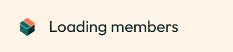
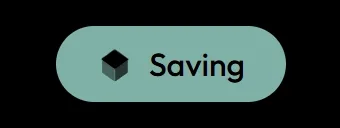

# Box-open loader

The Space Works loading animation. The box from the logo opens flap by flap, holds open, folds shut and repeats.
It is drawn from the logo's own paths, so it is always on-brand in both themes.

Open [`demo.html`](demo.html) in a browser to see every variant. Use the "Toggle dark" button to switch themes.

## Files

| File | What it is |
|---|---|
| `box-open.css` | All animation CSS: theme colours, keyframes, the `loop` cycle, the `mono` variant and the reduced-motion rule. |
| `box-open-markup.html` | The SVG markup to put inside the container: one `<svg class="lt">` for light and one `<svg class="dk">` for dark. |
| `demo.html` | A standalone page with the page loader, the inline spinner sizes and the button (mono) variant. |
| `react/` | The React components used by the SpaceWorks app (`LogoLoader`, `BoxSpinner`, `BoxArt`, and `brand/` with the logo hover cycle: `AnimatedLogoMark`, `LogoBoxOverlay`, `animatedLogo.css`), plus the generators in `boxOpen/` and the logo path masters they read. |

## Usage without React

```html
<link rel="stylesheet" href="box-open.css">

<div role="status" aria-label="Loading">
  <div class="sw-box loop" aria-hidden="true" style="width:78px;height:72px">
    <!-- paste box-open-markup.html here -->
  </div>
</div>
```

- The aspect ratio is fixed at **136 : 126**, so the width is the height × 136 / 126.
- The dark artwork shows when `<html>` has the class `dark`.
- Add `mono` (`class="sw-box loop mono"`) to draw it in the surrounding text colour, for example inside a button.

## The logo opens on hover and focus

The same artwork plays once (`sw-box hov`, 2200 ms) over the Space Works mark whenever it is hovered or keyboard-focused, everywhere it appears. It starts on the resting (open) logo, folds shut (600 ms, the loader's fold curve), then opens (1600 ms, the splash opening) back to the resting logo: no hold, no snap at either end.

- In the app every placement uses `components/brand/AnimatedLogoMark.tsx`; a guard test fails if the mark is drawn any other way.
- Without React: on pointer-enter (not `pointerType === "touch"`) or `focusin` that matches `:focus-visible` on the logo's link, mount `<div class="sw-box hov" style="position:absolute;inset:0">` + the markup over the logo's symbol and hide the static symbol paths; remove both on `animationend` of `sw-boxh-w`. Leaving mid-way lets the cycle finish; entering while it runs does not restart it.
- Skip it entirely when `prefers-reduced-motion: reduce` matches (the still mark shows). Touch never starts it.
- Add `g-dark` or `g-light` to force the artwork for a surface that is always dark or light; otherwise it follows `html.dark`.
- The `hov` CSS is in `box-open.css` (generated with the loop; the splash only carries `once`). It never loops outside the loader, tenant logos never animate, and the box never changes size.

Full rules, and every other animation in the product: [`../../docs/motion.md`](../../docs/motion.md).

## When to use which

| Use | Component | Height |
|---|---|---|
| A whole page or panel is loading | `LogoLoader` | 72px (default), centred |
| Buttons, table rows, fields, inline status | `BoxSpinner` | 16–24px (20px default) |
| Inside a filled button | `BoxSpinner mono` | the button's text size |
| A skeleton placeholder | `BoxArt` | matches the placeholder |

Use the box loader everywhere something loads. Don't use a generic spinner.

## Motion

- Opening (one-shot, on the cold-start splash): **1600 ms**.
- Loader cycle (open, hold, fold shut, repeat): **4400 ms**.
- Flaps open in the order bottom-left, top-left, bottom-right, top-right.
- Flap transforms are sampled per frame and played with `steps(1, end)`. Browsers glitch when they interpolate between two `matrix()` values near edge-on, so flap matrices are never interpolated; only opacity is.
- **Reduced motion:** under `prefers-reduced-motion: reduce` every animation stops and the still, open logo shows.

## Accessibility

- The wrapper has `role="status"` and an `aria-label` (default "Loading"), with matching visually hidden text.
- The artwork is `aria-hidden` and never focusable.
- In a busy button, set `aria-busy="true"` on the button.

## Source of truth

The generators live in the SpaceWorks app at `frontend/src/components/boxOpen/`. Its `boxOpen.sync.test.ts`
keeps the copy inlined in `index.html` (the splash) in step with them. The files here are generated from that
code for SpaceWorks 0.12.0. Regenerate them after any change to the generators or the logo masters.

The React components use Lingui (`t`) for the label and Tailwind utility classes for layout. Swap those for
your own i18n and CSS if you use them outside the app.

## Previews

Rendered from the real `box-open.css` and `box-open-markup.html` (frame-exact, 30 fps, 2x), so they always show
the current colours. Each has a `.gif` twin in `previews/`. The resting open logo is `previews/logo-open-light.png`
and `previews/logo-open-dark.png`.

| | Light | Dark |
|---|---|---|
| Page loader, 72px loop |  |  |
| Inline spinner, 20px row |  |  |
| Mono button "Saving" |  |  |
| Logo hover: fold, then open (`.sw-box.hov`, 2200 ms) |  |  |

Rebuild with `node scripts/make-previews.mjs` and verify freshness with `node scripts/check-previews.mjs`
(both from the repo root; see `tokens/README.md`).
