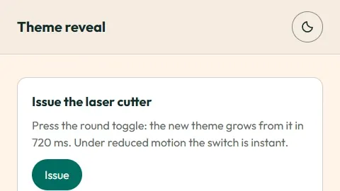

# Theme reveal

The Space Works light/dark switch animation. When someone presses the theme toggle, the new theme grows from the
toggle as a circle and covers the page in 720 ms, so the change reads as chosen, not as a flash. Where the browser
cannot do that it cross-fades; under reduced motion it switches instantly.



Open [`demo.html`](demo.html) in a browser for the real thing (a page, a round toggle and a Light / Dark / System
picker). It uses the design tokens from [`../../tokens/tokens.css`](../../tokens/tokens.css).

## Files

| File | What it is |
|---|---|
| `theme-reveal.css` | The View Transition rules, the registered `--sw-reveal` property for the soft edge, and the cross-fade fallback. |
| `theme-reveal.js` | Framework-free classic script. Exposes `SwThemeReveal.switchTheme(next, originEl)` and `SwThemeReveal.applyTheme(next)`. |
| `demo.html` | Standalone sample page with a toggle and a segmented picker, including the no-flash pre-paint script. |
| `react/` | The SpaceWorks app's own files: `themeTransition.ts` and `themeTransition.css` (the reveal), `theme.ts` (preference, system, storage), `themeReveal.ts` (wrapper), `ThemeToggle.tsx` and `ThemeChoice.tsx`. See the import note below. |
| `previews/` | The animated preview (`theme-reveal.webp`, `.gif`), generated by `scripts/make-previews.mjs`. |

## What it does

1. `switchTheme("dark", button)` finds the centre of `button`.
2. With View Transitions, the browser snapshots the old page, `html.dark` is toggled inside the transition callback,
   and the **new** snapshot is revealed through a circle that grows from the button's centre to the farthest page
   corner, **720 ms**, `cubic-bezier(0.45, 0, 0.2, 1)`. The edge is soft (a 160 px feather) where a registered custom
   property can animate inside a mask; elsewhere it is a hard `clip-path` circle. The final frame is held
   (`fill: "forwards"`) so the old theme never flashes back.
3. The preference is stored in `localStorage` under `makerspace.theme` (`light`, `dark` or `system`), the
   `<meta name="theme-color">` becomes `#FFF4E8` (light) or `#000000` (dark), and `html.dark` is the single source of
   truth. Storage failing (a private window) never stops the theme from changing for the session.

## Timing and tokens

| Part | Value |
|---|---|
| Reveal | 720 ms, `cubic-bezier(0.45, 0, 0.2, 1)`, grows from the toggle's centre |
| Soft edge | 160 px feather |
| Cross-fade fallback | 420 ms (class `sw-theme-fade` held for 460 ms) on `background-color`, `border-color`, `color`, `fill`, `stroke`, `box-shadow` |
| Colours | `tokens/tokens.css`: `html.dark` swaps every `--color-*` triplet; nothing else in the page changes |
| Browser chrome | `#FFF4E8` light, `#000000` dark |

The durations are deliberately longer than the 120 to 240 ms UI motion tokens: this is a page-level moment and never
blocks input (see `docs/motion.md`).

## Reduced motion and support

- `prefers-reduced-motion: reduce`: the theme changes instantly, with no reveal and no fade.
- No `document.startViewTransition` (Firefox before 144, older browsers): every colour cross-fades for 420 ms.
- No `CSS.registerProperty` or mask support: hard-edged circle via `clip-path` instead of the soft edge.
- If the animation API throws, the theme is still applied. The reveal is decoration, never a dependency.

## Usage without a framework

```html
<link rel="stylesheet" href="tokens/tokens.css">
<link rel="stylesheet" href="theme-reveal.css">
<script src="boot.js"></script>   <!-- no-flash pre-paint script from docs/theming.md, synchronous, in <head> -->

<button id="theme" type="button" aria-label="Switch theme">...</button>

<script src="theme-reveal.js"></script>
<script>
  document.getElementById("theme").onclick = function (e) {
    var dark = document.documentElement.classList.contains("dark");
    SwThemeReveal.switchTheme(dark ? "light" : "dark", e.currentTarget);
  };
</script>
```

`switchTheme(next, originEl, options)`: `next` is `"light"`, `"dark"` or `"system"`; `originEl` is the element the circle
grows from (omit it and the circle starts at the top right). Options: `storageKey` (default `makerspace.theme`),
`onApply(isDark)`, called inside the transition when the theme is painted, for apps that mirror the theme somewhere
else (the design site sets `data-theme` there), and `apply(next)`, which replaces the default painting entirely (the
Theming demo on the design site re-themes one container instead of `<html>`).

**Pair it with the pre-paint script.** The reveal only animates a change after the page is up. On first load the
synchronous `boot.js` in `<head>` (see [`docs/theming.md`](../../docs/theming.md), section 3) must already have put
`dark` on `<html>`, or a returning dark-mode visitor sees a light flash before anything can animate.

## Usage in React

Copy `react/` into the app (the SpaceWorks app keeps them at `frontend/src/lib/` and `frontend/src/components/`):

```tsx
import { useSyncExternalStore } from "react";
import { currentTheme, subscribeTheme } from "./lib/theme";
import { transitionTheme } from "./lib/themeTransition"; // imports ./themeTransition.css itself

function ThemeToggle() {
  const theme = useSyncExternalStore(subscribeTheme, currentTheme);
  return <button type="button" onClick={e => transitionTheme(theme === "dark" ? "light" : "dark", e.currentTarget)}>
    {theme === "dark" ? "Light" : "Dark"}
  </button>;
}
```

Call `initializeTheme()` from `theme.ts` once before `createRoot(...).render`.

### Import note for the `react/` copies

These are verbatim copies from the SpaceWorks app, so some imports point at app code that is not in this folder:

- `theme.ts` imports `./safeStorage` (`readStorage`, `writeStorage`: `localStorage` wrapped in `try/catch`). The plain
  `try/catch` versions in `docs/theming.md` section 4 are equivalent.
- `themeReveal.ts` is a thin wrapper kept for existing callers; new code can call `transitionTheme` directly.
- `ThemeToggle.tsx` and `ThemeChoice.tsx` use the app's `@lingui` translations, `useDelight`/`useReducedMotion`
  (`components/delight/DelightProvider`), `icons`, `ui/IconButton` and `ui/SegmentedControl`. Replace those with your
  own button and picker; the only theme-specific call is `transitionTheme`/`revealTheme`.
- `themeTransition.ts` also clears `data-sw-vt`, an app attribute a route transition uses. Drop that line if you
  have no route transitions.

## Source of truth

The SpaceWorks app (`frontend/src/lib/themeTransition.ts`, `themeTransition.css`, `lib/theme.ts`). `theme-reveal.js`
and `theme-reveal.css` are its framework-free mirror; change them together. `scripts/check-previews.mjs` fails when
`theme-reveal.css`, `theme-reveal.js` or `demo.html` change without the preview being regenerated
(`node scripts/make-previews.mjs theme-reveal`).
