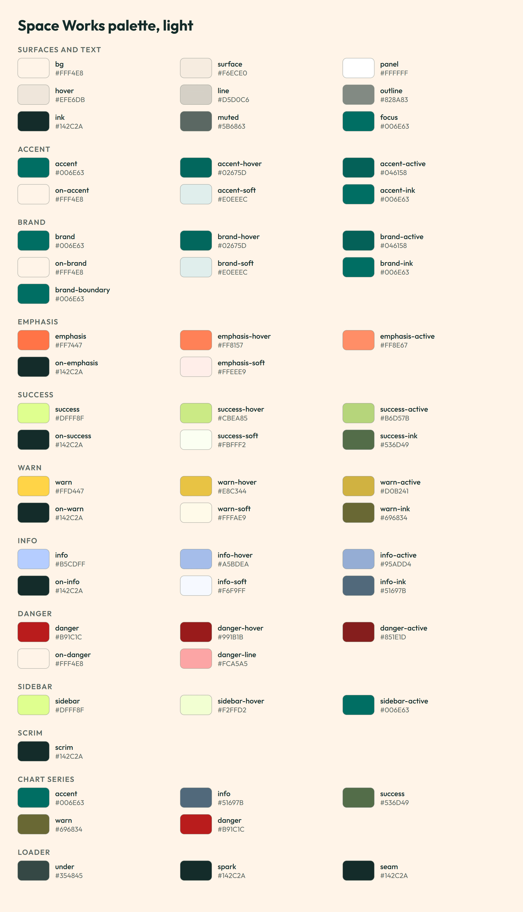
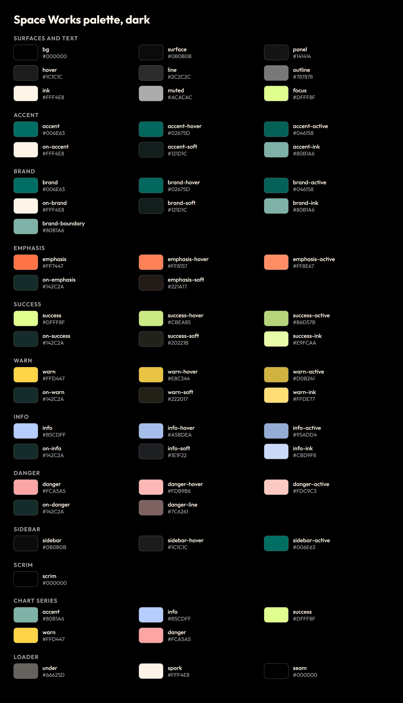
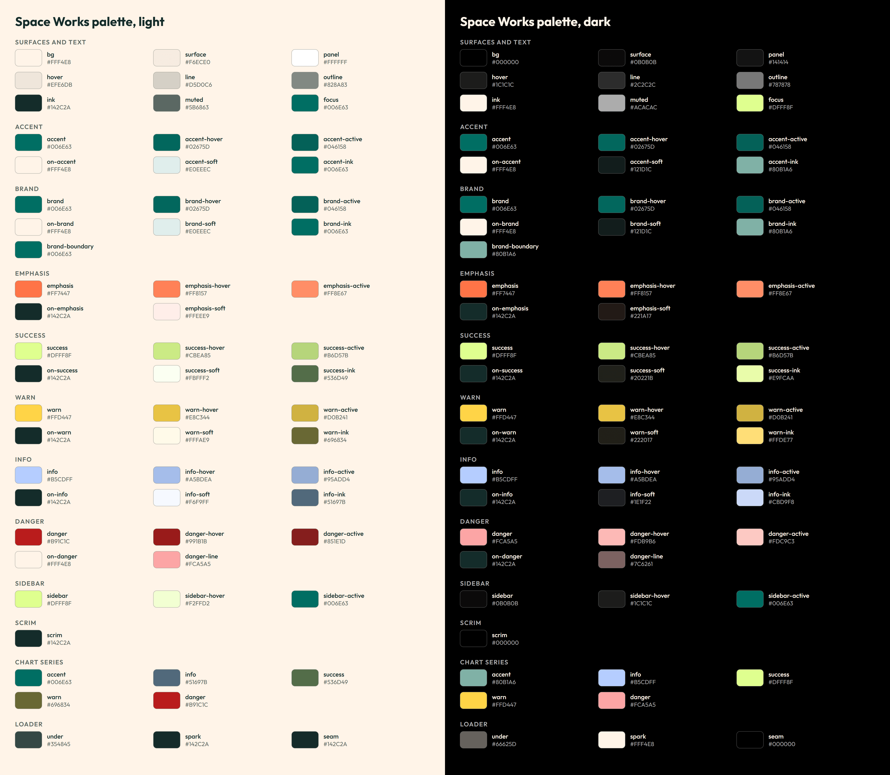

# Tokens

`tokens.json` is the source of truth for every colour role (light and dark), motion value, chart and loader colour.
`tokens.css` is the CSS form of the same values.

## Palette previews

Generated from `tokens.json`, so they cannot show an old palette. Each role is a labelled swatch with its hex,
grouped as surfaces/text, accent, brand, emphasis, success, warn, info, danger, sidebar, scrim, chart and loader.

| Light | Dark |
|---|---|
|  |  |



The editable SVG of each image sits beside it in `previews/` (`palette-*.svg`).

## Regenerating and checking the previews

```sh
node scripts/make-previews.mjs      # rebuild every palette + motion preview, rewrite scripts/previews.lock.json
node scripts/check-previews.mjs     # exit 1 if tokens.json / box-open.css / box-open-markup.html changed since
```

The generator needs Microsoft Edge (set `EDGE_PATH` to override its location) and `sharp` (taken from
`site/node_modules`). The check needs only Node: it compares SHA-256 hashes of the sources against
`scripts/previews.lock.json` and confirms every preview file exists. Run the generator after editing a token.
